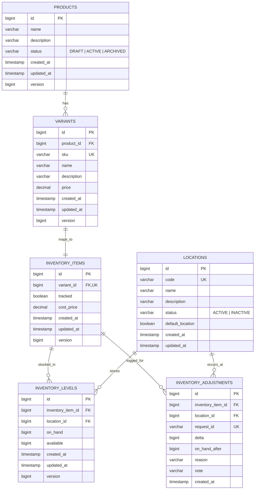

# Mini Inventory Management Service

Hệ thống Backend API quản lý kho hàng đơn giản, được xây dựng bằng Spring .
Boot 3.5 và PostgreSQL 17.

## Tính năng cơ bản

- **Quản lý kho hàng (`Location`)**: Tạo, tra cứu, cập nhật, đổi kho mặc định, đổi trạng thái kho.
- **Quản lý sản phẩm & biến thể (`Product` & `Variant`)**: Tạo sản phẩm kèm danh sách biến thể, tra cứu các sản phẩm &
  biến thể, chỉnh sửa khi cần thiết.
- **Quản lý tồn kho đa kho (`InventoryItem` & `InventoryLevel`)**:
    - Tự động khởi tạo mặt hàng kho `InventoryItem` 1-1 cho mỗi biến thể `Variant`.
    - Tự động kết nối tồn kho ban đầu tại kho mặc định cho các mặt hàng có bật theo dõi (`tracked = true`).
    - Hỗ trợ kết nối sản phẩm tới nhiều kho khác nhau và tra cứu tồn kho theo sản phẩm / kho / kết hợp cả hai.
- **Xuất/nhập kho kèm theo lưu log lịch sử (`InventoryAdjustment`)**:
    - Hỗ trợ xuất/nhập hàng hóa với lý do đi kèm.
    - Lưu audit log bất biến (`@Immutable`) kèm `onHandAfter` và lý do điều chỉnh.

---

## Các tính năng khác:

- **Toàn vẹn dữ liệu**:
    - Kiểm tra (Validation) đa tầng: DTO/Controller sử dụng Jakarta (Bean) Validation kiểm tra dữ liệu ngay từ đầu vào;
      Service sau đó cũng kiểm tra trong một số trường hợp; cuối cùng là Database với các ràng buộc dữ liệu
      (Constraint).
    - Sử dụng `@Transactional` để đồng nhất các thao tác thành 1 giao dịch, có cơ chế Rollback khi xảy ra lỗi.
    - Sử dụng kiểu dữ liệu `Long` kết hợp với hàm `Math.addExact()` và xử lý exception, phục vụ cho
      tính toán tồn kho, xuất / nhập kho, tránh nguy cơ tràn số gây sai lệch dữ liệu.
- **Xử lý truy cập đồng thời**
    - Áp dụng cơ chế **Optimistic locking** bằng việc bổ sung thuộc tính `@Version` cho hầu hết các entity (ngoại trừ
      `inventory_adjustment` do là bảng audit log lưu nhật kí ).
- **Hạn chế truy vấn N+1**
    - Sử dụng `@EntityGraph` để gom các truy vấn thành 1 truy vấn duy nhất bằng cơ chế `LEFT JOIN`.
    - Riêng truy vấn phân trang `Product` (quan hệ `@OneToMany` với `Variant`) được tách thành 2 bước:
        - Bước 1: Truy vấn các product `findAll(pageable)`
        - Bước 2: Truy vấn các variant của các product được truy vấn từ bước 1 (`findByProductIdIn` kết hợp
          `@EntityGraph("inventoryItem")`)
    - Mục đích: Tránh N+1 query, đồng thời tránh tình trạng Hibernate phải phân trang trong RAM (in-memory pagination)
      do `LEFT JOIN` bảng con 1-N làm nhân bản dữ liệu.

---

## Công nghệ sử dụng

| Thành phần    | Công nghệ / Phiên bản                                         |
|---------------|---------------------------------------------------------------|
| Ngôn ngữ      | Java 17                                                       |
| Framework     | Spring Boot 3.5.14 (`Web`, `Data JPA`, `Validation`) , Gradle |
| Cơ sở dữ liệu | PostgreSQL 17 (`postgres:17-alpine` qua Docker Compose)       |
| Tiện ích      | Lombok, Jakarta Bean Validation                               |

---

## Cấu trúc dự án

```text
product-manager/
├── build.gradle
├── database/
│   ├── db-compose.yaml            # Docker Compose chạy PostgreSQL 17
│   ├── .env.example               # Mẫu biến môi trường cho database
│   └── .env                       # File cấu hình biến môi trường cho database
└── src/
    ├── main/
    │   ├── java/com/example/productmanager/
    │   │   ├── ProductManagerApplication.java
    │   │   ├── common/
    │   │   │   ├── exception/     # GlobalExceptionHandler & các custom exceptions
    │   │   │   └── validator/     # Custom annotation (@NotZero)
    │   │   ├── location/          # Entity, Repo, Service, Controller, DTO kho hàng
    │   │   ├── product/           # Entity, Repo, Service, Controller, DTO sản phẩm & biến thể
    │   │   └── inventory/         # Item, Level, Adjustment, Service, Controller, DTO tồn kho
    │   └── resources/
    │       └── application.properties
    └── test/
        ├── java/com/example/productmanager/
        │   ├── BaseIntegrationTest.java
        │   ├── ProductManagerApplicationTests.java
        │   ├── SystemEndToEndIntegrationTest.java
        │   ├── common/validator/
        │   ├── location/
        │   ├── product/
        │   └── inventory/
        └── resources/
            └── application-test.properties
```

---

## Mô hình dữ liệu



**Các ràng buộc ở mức cơ sở dữ liệu:**

- `inventory_levels`: `UNIQUE (inventory_item_id, location_id)` và
  `CHECK (available >= 0 AND available <= on_hand AND on_hand >= 0)`.
- `inventory_adjustments`: `UNIQUE (request_id)` và `CHECK (delta <> 0)`.

---

## Quy tắc nghiệp vụ quan trọng

### Kho hàng (`Location`)

1. Kho hàng đầu tiên được tạo trong hệ thống luôn tự động là **kho mặc định** (`defaultLocation = true`).
2. Khi tạo kho mới với `defaultLocation = true` hoặc gọi API đổi kho mặc định, kho mặc định cũ sẽ tự động bị gỡ cờ mặc
   định.
3. Không thể đổi trạng thái kho mặc định sang `inactive`.
4. Không thể đặt một kho đang `inactive` làm kho mặc định.

### Sản phẩm & Biến thể (`Product` & `Variant`)

1. Mỗi sản phẩm khi tạo bắt buộc phải có ít nhất 1 biến thể (`variants` không rỗng); trạng thái mặc định là `active` nếu
   không truyền.
2. `sku` phải là duy nhất cả trong cùng một request tạo sản phẩm lẫn trên toàn bộ cơ sở dữ liệu.
3. Không thể thêm biến thể mới vào sản phẩm có trạng thái `archived`.

### Tồn kho & Biến động kho (`Inventory`)

1. Không thể kết nối (`connect`) hoặc xuất/nhập kho (`adjust`) nếu:
    - Sản phẩm đang ở trạng thái `archived`.
    - Kho hàng đang ở trạng thái `inactive`.
    - Mặt hàng có `tracked = false`.
2. Mỗi cặp `(inventoryItemId, locationId)` chỉ có tối đa 1 `InventoryLevel`.
3. Mỗi giao dịch `adjust` bắt buộc có `requestId` duy nhất để xử lý chống trùng lặp và `delta != 0`.
4. Xuất kho không được làm `available < 0`; mọi phép cộng/trừ tồn kho đều kiểm tra tràn số `Long`.

***Hiện tại nhập/xuất kho tạm thời cộng/trừ đồng thời cả 'onHand' lẫn 'available' với 'delta'. Logic có thể được điều
chỉnh dựa trên lý do ('reason') sau***.

---

## REST API

Tất cả các API phân trang sử dụng tham số chuẩn của Spring Data: `?page=0&size=10&sort=id,asc`.

### 1. Giá trị Enum trong JSON

Các enum được serialize/deserialize bằng chữ thường (`snake_case`):

| Enum                        | Giá trị JSON hợp lệ                                                                                                 |
|-----------------------------|---------------------------------------------------------------------------------------------------------------------|
| `LocationStatus`            | `"active"`, `"inactive"`                                                                                            |
| `ProductStatus`             | `"draft"`, `"active"`, `"archived"`                                                                                 |
| `InventoryAdjustmentReason` | `"inventory_initialize"`, `"inventory_adjust"`, `"inventory_change_by_damaged"`, `"inventory_change_by_correction"` |

---

### 2. Locations API (`/api/locations`)

| Method  | Endpoint                      | Mô tả                                                            | Status thành công |
|---------|-------------------------------|------------------------------------------------------------------|-------------------|
| `GET`   | `/api/locations`              | Danh sách kho (phân trang, mặc định `size=20, sort=id`)          | `200 OK`          |
| `GET`   | `/api/locations/{id}`         | Xem chi tiết kho theo ID                                         | `200 OK`          |
| `GET`   | `/api/locations/code/{code}`  | Xem chi tiết kho theo mã `code`                                  | `200 OK`          |
| `POST`  | `/api/locations`              | Tạo kho hàng mới                                                 | `201 Created`     |
| `PATCH` | `/api/locations/{id}`         | Cập nhật thông tin kho (`code`, `name`, `description`, `status`) | `200 OK`          |
| `PATCH` | `/api/locations/{id}/default` | Chuyển kho có mã `id` thành kho mặc định                         | `200 OK`          |

**Ví dụ tạo kho (`POST /api/locations`):**

```json
{
  "code": "WH-HN",
  "name": "Kho Ha Noi",
  "description": "Kho trung tam khu vuc phia Bac",
  "defaultLocation": true
}
```

---

### 3. Products API (`/api/products`)

| Method  | Endpoint             | Mô tả                                                         | Status thành công |
|---------|----------------------|---------------------------------------------------------------|-------------------|
| `GET`   | `/api/products`      | Danh sách sản phẩm kèm variants (mặc định `size=10, sort=id`) | `200 OK`          |
| `GET`   | `/api/products/{id}` | Xem chi tiết sản phẩm kèm variants theo ID                    | `200 OK`          |
| `POST`  | `/api/products`      | Tạo mới sản phẩm kèm danh sách biến thể                       | `201 Created`     |
| `PATCH` | `/api/products/{id}` | Cập nhật sản phẩm (`name`, `description`, `status`)           | `200 OK`          |

**Ví dụ tạo sản phẩm (`POST /api/products`):**

```json
{
  "name": "Ao Thun Basic",
  "description": "Chat lieu 100% Cotton",
  "status": "active",
  "variants": [
    {
      "sku": "AT-BASIC-S",
      "name": "Size S",
      "description": "Ao size S",
      "price": 199000.00,
      "costPrice": 90000.00,
      "tracked": true
    },
    {
      "sku": "AT-BASIC-M",
      "name": "Size M",
      "description": "Ao size M",
      "price": 199000.00,
      "costPrice": 90000.00,
      "tracked": true
    }
  ]
}
```

---

### 4. Variants API (`/api/variants`)

| Method  | Endpoint                             | Mô tả                                                            | Status thành công |
|---------|--------------------------------------|------------------------------------------------------------------|-------------------|
| `GET`   | `/api/variants`                      | Danh sách các biến thể (phân trang, mặc định `size=20, sort=id`) | `200 OK`          |
| `GET`   | `/api/variants/{id}`                 | Xem chi tiết biến thể theo ID                                    | `200 OK`          |
| `GET`   | `/api/variants/sku/{sku}`            | Xem chi tiết biến thể theo SKU                                   | `200 OK`          |
| `POST`  | `/api/products/{productId}/variants` | Thêm biến thể mới cho sản phẩm                                   | `201 Created`     |
| `PATCH` | `/api/variants/{id}`                 | Cập nhật biến thể (`sku`, `name`, `description`, `price`)        | `200 OK`          |

**Ví dụ thêm biến thể (`POST /api/products/{productId}/variants`):**

```json
{
  "sku": "AT-BASIC-L",
  "name": "Size L",
  "description": "Ao size L",
  "price": 209000.00,
  "costPrice": 95000.00,
  "tracked": true
}
```

---

### 5. Inventory API (`/api/inventory`)

| Method  | Endpoint                     | Mô tả                                                                                                                                                 | Status thành công |
|---------|------------------------------|-------------------------------------------------------------------------------------------------------------------------------------------------------|-------------------|
| `GET`   | `/api/inventory`             | Tra cứu tồn kho. Hỗ trợ lọc tùy chọn `?inventoryItemId=&locationId=` (mặc định `size=10, sort=id`)                                                    | `200 OK`          |
| `POST`  | `/api/inventory/connect`     | Kết nối một `inventoryItem` vào một kho (`location`)                                                                                                  | `201 Created`     |
| `POST`  | `/api/inventory/adjust`      | Điều chỉnh tồn kho (nhập/xuất/hỏng/kiểm kê) và ghi audit log                                                                                          | `201 Created`     |
| `GET`   | `/api/inventory/adjustments` | Xem lịch sử biến động kho. **Bắt buộc** truyền `?inventoryItemId=&locationId=` (mặc định `size=10`, sắp xếp mới nhất trước theo `createdAt, id DESC`) | `200 OK`          |
| `PATCH` | `/api/inventory/items/{id}`  | Cập nhật cấu hình mặt hàng tồn kho (`tracked`, `costPrice`)                                                                                           | `200 OK`          |

**Ví dụ kết nối tồn kho (`POST /api/inventory/connect`):**

```json
{
  "locationId": 2,
  "inventoryItemId": 1
}
```

**Ví dụ điều chỉnh tồn kho (`POST /api/inventory/adjust`):**

```json
{
  "inventoryItemId": 1,
  "locationId": 1,
  "requestId": "ADJ-20261127-001",
  "delta": 50,
  "reason": "inventory_initialize",
  "note": "Nhap kho dot dau"
}
```

**Ví dụ cập nhật Inventory Item (`PATCH /api/inventory/items/{id}`):**

```json
{
  "tracked": true,
  "costPrice": 92000.00
}
```

---

## Chuẩn phản hồi lỗi

Toàn bộ ngoại lệ được xử lý tập trung tại `GlobalExceptionHandler`.

### Bảng ánh xạ HTTP Status

| HTTP Status                 | Nguyên nhân                                                                                                                                                                     |
|-----------------------------|---------------------------------------------------------------------------------------------------------------------------------------------------------------------------------|
| `400 Bad Request`           | Vi phạm nghiệp vụ (`BusinessException`), lỗi validation DTO (`@Valid`), sai kiểu tham số, thiếu query param bắt buộc, JSON hoặc enum không hợp lệ                               |
| `404 Not Found`             | Không tìm thấy tài nguyên (`ResourceNotFoundException`) hoặc đường dẫn không tồn tại                                                                                            |
| `405 Method Not Allowed`    | Gọi sai HTTP method cho endpoint                                                                                                                                                |
| `409 Conflict`              | Trùng tài nguyên (`DuplicateResourceException`), vi phạm ràng buộc DB (`DataIntegrityViolationException`), xung đột Optimistic Lock (`ObjectOptimisticLockingFailureException`) |
| `500 Internal Server Error` | Lỗi hệ thống không mong muốn                                                                                                                                                    |

### Cấu trúc JSON lỗi chung (`ErrorResponse`)

```json
{
  "status": 404,
  "error": "Not Found",
  "message": "Location not found",
  "path": "/api/locations/999",
  "timestamp": "2026-11-27T14:00:00"
}
```

### Cấu trúc JSON lỗi Validation (`ValidationErrorResponse`)

```json
{
  "status": 400,
  "error": "Bad Request",
  "message": "Validation error",
  "fieldErrors": {
    "delta": "Delta cannot be zero",
    "requestId": "Request Id cannot be empty"
  },
  "path": "/api/inventory/adjust",
  "timestamp": "2026-11-27T14:00:00"
}
```

---

## Hướng dẫn cài đặt & Chạy ứng dụng

### Yêu cầu môi trường

- **JDK 17** trở lên
- **Docker** và **Docker Compose** (để chạy PostgreSQL cục bộ)

### Bước 1: Thiết lập biến môi trường cho PostgreSQL

Sao chép file mẫu và điền thông tin kết nối cục bộ vào `database/.env` (file này đã nằm trong `.gitignore`,
không commit lên Git):

```bash
cp database/.env.example database/.env
```

Ví dụ nội dung `database/.env` (dùng giá trị cục bộ của bạn):

```dotenv
POSTGRES_USER=your_postgres_user
POSTGRES_PASSWORD=your_postgres_password
POSTGRES_DB=product_manager
POSTGRES_PORT=5432
```

### Bước 2: Khởi động PostgreSQL bằng Docker Compose

```bash
docker compose -f database/db-compose.yaml --env-file database/.env up -d
```

### Bước 3: Cấu hình ứng dụng

Đảm bảo file `src/main/resources/application.properties` được cấu hình khớp với database đã khởi tạo ở Bước 1 (nên dùng
biến môi trường; không hardcode mật khẩu thật, đặc biệt khi chia sẻ ra ngoài):

```properties
spring.datasource.url=jdbc:postgresql://localhost:5432/product_manager
spring.datasource.username=your_postgres_user
spring.datasource.password=your_postgres_password
spring.jpa.hibernate.ddl-auto=update
```

### Bước 4: Chạy ứng dụng Spring Boot

```bash
./gradlew bootRun
```

Ứng dụng mặc định lắng nghe tại `http://localhost:8080`.
